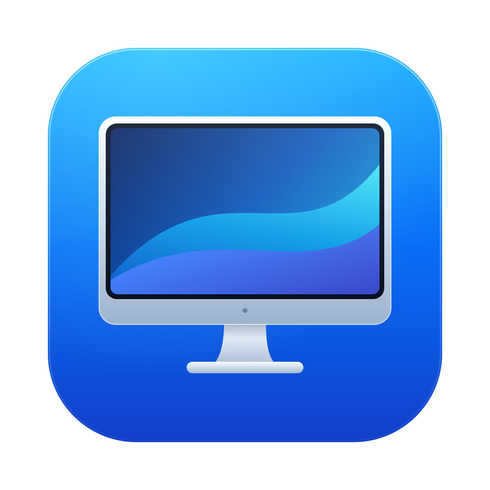

  

<h1 align="center">MonitorBar</h1>

<strong>Seu espaço, do seu jeito.</strong>

Controle o brilho, a imagem e a disposição das suas telas direto da barra de menus do Mac.

Nativo para macOS &nbsp;·&nbsp; Interface em português &nbsp;·&nbsp; Sem conta &nbsp;·&nbsp; Sem telemetria

## Todas as telas. Um só lugar.

O MonitorBar reúne os ajustes dos seus monitores em um painel compacto. Abra o ícone na barra de menus para ver as telas conectadas, conferir a configuração de cada uma e fazer os ajustes do dia a dia.

A tela do notebook e os monitores externos aparecem em cartões individuais, com nome, identificação da tela principal, brilho, resolução e frequência. O app fica na barra de menus, sem ocupar espaço no Dock.

| Para ajustar…           | O MonitorBar oferece…                                              |
| :---------------------- | :----------------------------------------------------------------- |
| A iluminação            | Brilho individual por tela, com controle físico quando disponível. |
| O tamanho dos elementos | Seleção de escala e resolução, com identificação de HiDPI.         |
| A fluidez da imagem     | Frequências de atualização oferecidas pelo monitor e pelo macOS.   |
| O espaço de trabalho    | Organização visual, escolha da tela principal e espelhamento.      |
| A orientação            | Rotação de monitores externos compatíveis.                         |

## Sua mesa, na tela

Arraste as telas para que a disposição no Mac acompanhe a sua mesa: notebook à esquerda, monitor principal à direita, ou uma tela acima da outra. O encaixe de bordas ajuda a alinhar os monitores.

Selecione uma tela para ver seus detalhes e definir qual será a principal. Quando a disposição estiver como você quer, aplique a alteração e confira o resultado antes de mantê-lo.

